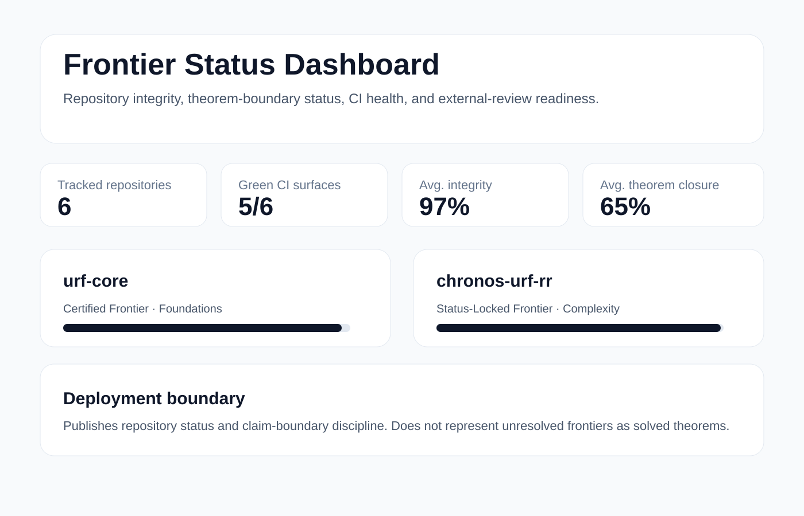

# Frontier Status Dashboard

## Public verification checkpoint update (2026-11-24)

[Scoped source and merge ledger](docs/status/PUBLIC_MERGED_VERIFICATION_CHECKPOINTS_2026_11_24.md) · [Verification Explorer](https://frontier-status-dashboard.vercel.app/verification)

Four public PR merges are now indexed as separate verification claims: URF Core #599 (**LEAN_VERIFIED_ISOLATED**, Mac-reported axiom audit 6/6), URF Core #602 (FO-k/H1 scope correction), DFM-MKC #327 (observational evidence-boundary correction), and Poincaré #197 (**COMPUTATION_PASS**, 104 finite U(16) witnesses). Two further private-source changes are intentionally omitted from the public listing. Status/progress percentages and historical snapshots were not altered; independent Poincaré and graph-level H1 remain **OPEN**.

## TKSV conditional Poincaré status (2026-11-22)

[Scoped certificate ledger](docs/status/TKSV_PACHNER_CONDITIONAL_EQUIVALENCE_2026_11_22.md) · [Public research status page](https://inaciovasquez2020.github.io/research/tksv-pachner-status-20261122.html)

The universal strict net vertex-descent hypothesis G is **equivalent** to Poincaré under classical three-manifold PL results; it is not an independent solution. Explicit positive-g2 Pachner normalization families and move-count lower bounds have finite certificates. **INDEPENDENT_GLOBAL_POINCARE := OPEN; LEAN_NEW_BUILD := NOT_RUN.**

<!-- VERIFIED_FRONTIER_TRACKING_TRANSPARENCY:BEGIN -->
## Verified Frontier Tracking Transparency Proof

This dashboard is the first public proof of transparency for **Verified Frontier Tracking**.

It exposes the public status surface for hard research claims:

| Signal | Meaning |
|---|---|
| CI health | Whether the public verification surface currently builds or tests |
| Repository integrity | Whether declared status artifacts remain internally consistent |
| Theorem-boundary status | Whether a result is proved, conditional, interface-only, or still open |
| External-review readiness | Whether an outside reader can inspect the current claim boundary |

Boundary: dashboard success certifies status visibility and repository-health signals only. It does not convert open frontiers, conditional bridges, or interface objects into theorem-level closure.
<!-- VERIFIED_FRONTIER_TRACKING_TRANSPARENCY:END -->

- Verified Frontier Tracking public door complete: `docs/status/VERIFIED_FRONTIER_TRACKING_PUBLIC_DOOR_2026_05_09.md`


<!-- VERIFIED_FRONTIER_TRACKING_DOOR:BEGIN -->
See [dashboard signals](#verified-frontier-tracking-transparency-proof) and the [live dashboard](https://frontier-status-dashboard.vercel.app).
<!-- VERIFIED_FRONTIER_TRACKING_DOOR:END -->

## Verified URF entropy and transcript checkpoint (2026-11-20 UTC)

[Exact source commit](https://github.com/inaciovasquez2020/urf-core/commit/47531c87ff8556f4c1b81a3adb713aa1fe7e1c14) · [PR #596](https://github.com/inaciovasquez2020/urf-core/pull/596) · [Successful integration CI](https://github.com/inaciovasquez2020/urf-core/actions/runs/44642702617)

**LEAN_VERIFIED at the pinned PR revision:** for a finite graph over a finite field K, restriction of global cycle-space linear functionals to radius-one local cycles leaves conditional entropy at most dim H₁(Cl(G); K) log |K|, with equality for uniform input. The finite sequential mutual-information chain rule and transcript capacity bounds also compile. The Mac build completed 7,956 jobs and audited 15 imported declarations using only propext, Classical.choice and Quot.sound; all nine remote workflows passed.

Source declarations: [SharpCliqueEntropy.lean](https://github.com/inaciovasquez2020/urf-core/blob/47531c87ff8556f4c1b81a3adb713aa1fe7e1c14/lean/URF/Foundation/SharpCliqueEntropy.lean) (radiusOne_entropy_le_cliqueH1_candidate, radiusOne_uniform_entropy_eq_cliqueH1_candidate); [FiniteTranscriptChainInduction.lean](https://github.com/inaciovasquez2020/urf-core/blob/47531c87ff8556f4c1b81a3adb713aa1fe7e1c14/lean/URF/Foundation/FiniteTranscriptChainInduction.lean) (transcript_mutual_information_eq_chain_cmi_sum).

**Boundary:** PR revision, not a main-branch merge claim. Classical information identities and linear algebra are established; originality of the specific synthesis and formalization remains OPEN pending independent review. A direct graph-specific sequential observation theorem and global URF rigidity remain OPEN. This status surface does not independently prove the results.

## Verified update of November 9, 2026

- Date: 2026-11-09 (UTC)
- Scope: public GitHub pull-request merge receipts, checked against their exact merge commit IDs; **not** a fresh dashboard-wide inventory synchronization.
- Poincaré local verification infrastructure: [PR #166](https://github.com/inaciovasquez2020/poincare-new-derivation/pull/166) merged as [`dd75527f`](https://github.com/inaciovasquez2020/poincare-new-derivation/commit/dd75527f0958d0dcf5e9d0fe1d480ec793b12d38) (finite-certificate and axiom-audit controls); [PR #170](https://github.com/inaciovasquez2020/poincare-new-derivation/pull/170) merged as [`8e2c45b1`](https://github.com/inaciovasquez2020/poincare-new-derivation/commit/8e2c45b14b3f5aa5def88737803520d4036c733a) (focused CI dependency triggers).
- Public claim-integrity improvements: [Math Lab #32](https://github.com/inaciovasquez2020/inaciovasquez2020.github.io/pull/32) merged as [`4a9a6c11`](https://github.com/inaciovasquez2020/inaciovasquez2020.github.io/commit/4a9a6c118039df504c39762d1af8000ac755ab7b); [URF Core #589](https://github.com/inaciovasquez2020/urf-core/pull/589) merged as [`98ddf8ba`](https://github.com/inaciovasquez2020/urf-core/commit/98ddf8badd694dd3b659047fd64d8c830718bd81), correcting DraG0n R4 to **OPEN**.
- Verification reporting improvements: [Textbook #177](https://github.com/inaciovasquez2020/urf-textbook/pull/177) merged as [`af284de1`](https://github.com/inaciovasquez2020/urf-textbook/commit/af284de1bbd9913e527cc8763eac2d2079f8b94a); [DFM-MKC #334](https://github.com/inaciovasquez2020/dfm-mkc-cosmology/pull/334) merged as [`8a7e26a7`](https://github.com/inaciovasquez2020/dfm-mkc-cosmology/commit/8a7e26a72fe58663ed4d974840535cd25c3ac535), with conditional scientific scope retained.
- **Open boundary:** universal stabilized descent, global JIID, the independent Poincaré derivation, unrestricted DFM-MKC physical claims, and DraG0n R4 are **not proved** by these merges. Green CI applies to the declared local checks only.
- Historical dashboard inventory checkpoint: the last specifically cited inventory synchronization in this note is the **2026-11-01** [workflow run 41315352268](https://github.com/inaciovasquez2020/frontier-status-dashboard/actions/runs/41315352268), producing [`72e58f6`](https://github.com/inaciovasquez2020/frontier-status-dashboard/commit/72e58f616ccacec873fa80f671c12bc50d43ee36). No November 9 dashboard inventory run is asserted here.


[](https://github.com/inaciovasquez2020/frontier-status-dashboard/actions/workflows/ci.yml)
[](https://frontier-status-dashboard.vercel.app)
[](https://github.com/inaciovasquez2020/frontier-status-dashboard)

**Live product:** https://frontier-status-dashboard.vercel.app

**Repository:** https://github.com/inaciovasquez2020/frontier-status-dashboard
Public product surface for tracking repository integrity, CI health, theorem-boundary status, proof-hole visibility, and external-review readiness across the Vasquez Research program.



## Product value

This dashboard turns a distributed research-program surface into a single commercial-facing artifact:

- repository status visibility
- theorem-boundary discipline
- CI/test/build credibility
- proof-hole and conditional-frontier separation
- external-review readiness

## Deployment boundary

This product publishes repository status, CI health, proof-hole visibility, and claim-boundary discipline.

It does not represent unresolved mathematical frontiers as solved theorems.

## Commands

```bash
npm ci
npm run test
npm run build
Optional repository-data ingestion
GITHUB_TOKEN="$(gh auth token)" npm run ingest
npm run test
npm run build
Deploy
npm install -g vercel
vercel --prod
Repository
https://github.com/inaciovasquez2020/frontier-status-dashboard


## Recent Status Updates — 2026-06-13
- urf-textbook: bounded-closure proof pattern section pushed in commit `8def1fc`; validation: `python3 scripts/check_placeholders.py`, `python3 -m py_compile scripts/check_placeholders.py`, and `git diff --check`.
- urf-textbook: placeholder checker formatting pass pushed in commit `7741abb`; validation: `python3 scripts/check_placeholders.py`, `python3 -m py_compile scripts/check_placeholders.py`, and `git diff --check`.
- Boundary: documentation/status-surface update only; no theorem-level closure, mathematical closure, or dashboard theorem-promotion claim is introduced.

## Recent Status Updates — 2026-06-02

- URF-core: finite-state Markov-kernel stack closed inside the bounded formal domain via PR #374 / commit 8f990a8. Boundary: no unrestricted URF law closure, no empirical gravity validation, no P vs NP, and no Clay-problem closure.
- Finite graph distance layer: GlobalSLASHAxiomsDischarge, GlobalDistanceTriangleTheoremUnconditionalOnSLASH, and DistanceSymmetryForUndirectedGraphClass recorded closed. Boundary: directed symmetry remains not closed.

## Recent Status Updates

- Biological Friction Framework: quotient-linear substrate SOLVED/PUSHED in biological-friction-framework commit 3022c38; graph-theoretic quotient-independence remains FRONTIER_OPEN.

## Private repository metadata policy

Private repository metadata is intentionally omitted from the public dashboard. Public rows are limited to externally inspectable repositories or intentionally disclosed aggregate status.

Boundary: no theorem-level closure is claimed unless explicitly public and inspectable.

## Chronos PR #217 public status

Chronos PR #217 merged the RankRateGap axiomatic bridge.

Boundary: axiom-dependent bridge only; no theorem-level RankRateGap proof, no unconditional UniversalFiberEntropyGap closure, no DepthBridge beyond selected final carrier domain, no Chronos-RR theorem promotion, no P vs NP closure, and no Clay-problem closure.

Boundary guard: No theorem-level H4.1/FGL closure; FRONTIER_OPEN is preserved; No UniversalFiberEntropyGap from Reg-SNF; Axiom-dependent RankRateGap bridge only; no theorem-level RankRateGap proof; no unconditional UniversalFiberEntropyGap closure; no DepthBridge beyond selected final carrier domain; no Chronos-RR theorem promotion; no P vs NP or Clay-problem closure.

## Chronos Lean library target exposure

- Date: 2026-05-10
- Repository: `chronos-urf-rr`
- Commit: `23b0a96`
- Status: `LEAN_LIBRARY_TARGET_EXPOSED`
- Update: Chronos Lean library target exposed and `XorLemmas` proof mechanics repaired.
- Boundary: build/exposure/proof-mechanics repair only; no theorem-level Chronos-RR, UniversalFiberEntropyGap, unrestricted H4.1/FGL, P vs NP, or Clay-problem closure.

## Chronos PR233 status update — 2026-05-12

Chronos `chronos-urf-rr` now records PR #231, PR #232, and PR #233 as merged surfaces:

- RepositoryNativeZeroArityInterface closure.
- Zero-arity exhaustiveness to Reg-SNF bridge.
- Current real Chronos-admissible unrestricted Reg-SNF status lock.
- Selected DepthBridge reachability only.

Historical dashboard scalars recorded on 2026-05-12:

- Repository integrity was reported as 100% by the dashboard at that time.
- A value of 82 was displayed under the old “Theorem closure” label for Chronos. The underlying data marks `theoremMetricApplicable: false` and labels unrestricted theorem closure false. This scalar is not a percentage of a theorem proved or a research program completed; the UI now labels such values “Scoped closure-scale indicator.”

Boundary preserved: no UniversalFiberEntropyGap closure, no DepthBridge beyond selected final carrier domain, no Chronos-RR theorem-level closure, no H4.1/FGL theorem-level closure, no P vs NP closure, and no Clay-problem closure.

## Chronos PR254 status update — 2026-05-13

Chronos `chronos-urf-rr` now records PR #254 as a merged repository-native rank/ambient datum surface.

- Repository integrity was reported as 100% in the historical dashboard snapshot.
- The historical value 82 was a scoped dashboard scalar, not a theorem-completion percentage.
- Status: `CONDITIONAL_EXTERNAL_DATA_ASSUMPTION_ONLY`.
- Verified: rank/ambient datum verifier, targeted pytest 3/3, `lake build`, full pytest 646/646.

Boundary preserved: metadata is not theorem-level source validity; importer is not formalized in Lean; no unconditional `SemanticRankRateCertificate`; no unrestricted `UniversalFiberEntropyGap` theorem; no Chronos-RR closure; no H4.1/FGL closure; no P vs NP closure; and no Clay-problem closure.

## Profile row removal — 2026-05-13

Removed the `inaciovasquez2020` profile/start-here row from the dashboard data because it is navigation/profile-only and does not require theorem closure.

Boundary preserved: no theorem status changed; no Chronos theorem closure changed; no UniversalFiberEntropyGap theorem; no Chronos-RR closure; no H4.1/FGL closure; no P vs NP closure; no Clay closure.

<!-- DASHBOARD_STATUS_START -->
## Current Dashboard Status

Status: `DASHBOARD_SYNC_CURRENT_NO_THEOREM_PROMOTION`

Current synced main-chain status:

```text
#206 GitHub Pages documentation root status
#204 urf-templates root status
#202 urf-verifier root status
#200 theorem-closure-classifier root status
#198 URF Textbook CI-state refresh
#196 Vasquez Index boundary refresh
```

Current verification state:

```text
Vitest: 89 files / 332 tests passed
Build: passed
Public repository inventory: 19
Profile/start-here repository: inventory-only by explicit dashboard guard
Verified snapshot source HEAD: b99a200ef43d3de9067ca209f4b1e925fbd9a0c1
```

Dashboard role:

This repository synchronizes public-facing frontier status data, source maps, status documents, and no-promotion tests across the URF/Chronos research program.

Boundary:

- dashboard/index/CI success does not establish theorem-level closure
- no analytic Einstein-matter bootstrap package proof
- no concrete analytic Einstein-matter estimate package proof
- no gravity closure
- no Chronos-RR
- no H4.1/FGL
- no P vs NP
- no Clay problem
<!-- DASHBOARD_STATUS_END -->

<!-- REPOSITORY_BOUNDARY_ROWS_BEGIN -->
# Repository boundary rows

| Repository | Status | Explicit non-closure boundary |
|---|---|---|
| [`dfm-mkc-cosmology`](https://github.com/inaciovasquez2020/dfm-mkc-cosmology) | public executable cosmology consistency surface | `BOUNDARY := ¬ dfm_mkc_executable_consistency_checks_imply_cosmology_or_gravity_closure` |
| [`cslib-fmt`](https://github.com/inaciovasquez2020/cslib-fmt) | public Lean finite-model-theory support layer | `BOUNDARY := ¬ cslib_fmt_library_interfaces_imply_finite_model_theory_problem_closure` |
<!-- REPOSITORY_BOUNDARY_ROWS_END -->

<!-- CHRONOS_TOTAL_UPDATE_2026_06_30_START -->
## Chronos Total Update — 2026-06-30

STATUS := good stopping point for today

TOTAL_UPDATE :=
- PR #924 merged: added a known closed Cantor theorem benchmark.
- PR #925 merged: recorded a local timing baseline for the known closed Cantor benchmark.
- PR #926 merged: added `THEOREM_LEDGER.md`, a proof-portfolio index of Lean theorem/lemma declarations.

MAIN_COMMITS :=
- `51c763c52fbe49043f5feb6c1e36c6270f3c0721` — known closed Cantor boundary demo
- `45b65b9257aa0dddbc23d76694f2a8baca1ae08b` — known closed Cantor timing baseline
- `e8782a881c594684c8cf5d1553f9d6f5946e65ec` — theorem ledger

VALIDATION :=
- PR #924 main-push CI: all tracked checks passed.
- PR #925 main-push CI: all tracked checks passed.
- PR #926 main-push CI: all tracked checks passed.

PUBLIC_MEANING :=
The program now demonstrates that it can accept a genuinely proved theorem, record bounded timing measurements for that verification, and index its Lean proof declarations in a public theorem ledger.

BOUNDARY :=
This does not prove P vs NP, Chronos-RR, gravity, cosmology, foundations-of-physics closure, general proof efficiency, or open-problem acceleration.

TODAY_STOP :=
No more structural work planned for today.
<!-- CHRONOS_TOTAL_UPDATE_2026_06_30_END -->

<!-- CROSS_REPO_HISTORICAL_TOTAL_2026_06_30_START -->
## Cross-Repo Historical Total — 2026-06-30

STATUS := tracked historical dashboard total

SUMMARY :=
A full tracked cross-repo historical total has been added in `CROSS_REPO_HISTORICAL_TOTAL_2026_06_30.md`.

COVERED_REPOS :=
- `chronos-urf-rr`
- `phase-transition-pnp`
- `dfm-mkc-cosmology`
- `cslib-fmt`
- `urf-templates`
- `urf-verifier`
- `urf-textbook`
- `iris-lean`
- `frontier-status-dashboard`
- `vasquez-index`

BOUNDARY :=
This is a status ledger only. It does not prove P vs NP, Chronos-RR, gravity, cosmology, foundations-of-physics closure, general proof efficiency, open-problem acceleration, or exhaustive cross-repo audit completeness.
<!-- CROSS_REPO_HISTORICAL_TOTAL_2026_06_30_END -->

## Cross-domain information recovery — 2026-11-27 UTC

Three source-linked entries in the Verification Explorer: [BFF #116 merged](https://github.com/inaciovasquez2020/biological-friction-framework/blob/799b41b4692c71589587cba037f26f0ad4bff7fb/proofs/hidden-dissipation/receipt/HiddenDissipation.lean) (33 declarations), [BFF #117 merged](https://github.com/inaciovasquez2020/biological-friction-framework/blob/c5c8b2f24a0d4de57c764c161ab29c3689bec62f/proofs/hidden-dissipation/receipt/HiddenDissipation.lean) (8 additional; cumulative 41/41), and [Chronos #1392 exact PR revision](https://github.com/inaciovasquez2020/chronos-urf-rr/blob/2ed7df1497824343fce34924501d42a220c3006f/research/certificates/cosmology_causal_projection/receipt/CausalProjection.lean) (11/11, dedicated Lean CI PASS, broader integration pending). **52 distinct audited declarations**, counted once. These are scoped mathematical comparisons, not physical unification. Full analytic formalization, empirical validation, physical 5D detection and independent novelty OPEN. No historical counts or portfolio progress percentages changed.

## Universal scalar recovery and sharp noisy dissipation — subsequent 2026-11-27 UTC checkpoint

The [universal recovery source](https://github.com/inaciovasquez2020/biological-friction-framework/blob/76317e758f932638945934bcac2ce9ffa7fa3d31/proofs/hidden-dissipation/recovery/UniversalRecovery.lean) and [analytic entropy convexity source](https://github.com/inaciovasquez2020/biological-friction-framework/blob/76317e758f932638945934bcac2ce9ffa7fa3d31/proofs/hidden-dissipation/recovery/EntropyConvexity.lean) at BFF PR #119 are Mac LEAN_VERIFIED, with 57/57 permitted-axiom audits (16 additional declarations beyond the earlier 41). Fresh Linux reproduction is pending at this pinned PR revision. Combined with the separate 11-declaration Chronos causal-projection certificate, the dated cross-domain count is **68 distinct audited declarations**, not 52 + 57. The preceding checkpoint remains historical.

The compatibility-relation theorem `URF.Transfer.recoverable_iff_pairwise` characterizes achievable scalar worst-case error by the bound 2E on every compatible target pair. `URF.Transfer.affine_transfer` transfers this bound under specified system and observation equivalences and affine target changes. These are classical optimal-recovery foundations in a formalized general setting, not a priority claim. `BFF.HiddenDissipation.noisy_ring_curvature_minimax_unconditional` proves the sharp bounded-error entropy recovery formula (with entropy convexity discharged) for the specified ring family: delta = min(M^2, 2 epsilon/c_i), E* = (S(M^2) - S(M^2-delta))/2. `BFF.HiddenDissipation.noisy_mode_minimax` proves the corresponding restricted coupling recovery bound. Empirical validation, full physical derivations, a fundamental physical law and independent mathematical novelty remain OPEN.
